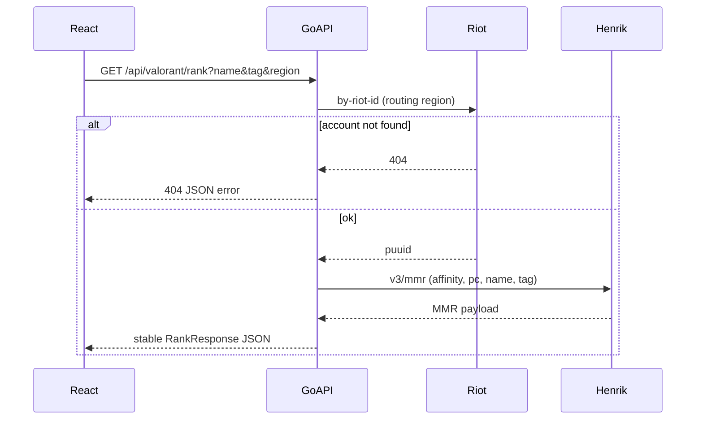

# Valorant rank proxy (Go + React) — documentation and scaffold

## Context

The repo [README.md](README.md) is currently a title only. Your goal is **documentation-first**, then a **minimal working stack**: Go backend exposing `GET /api/valorant/rank`, React frontend, aligned with the proxy pattern you described.

**Hybrid provider choice (your selection):**

| Field | Source | Why |
|-------|--------|-----|
| Riot ID exists, `puuid` | [Riot Account API](https://developer.riotgames.com/apis#account-v1/GET_getByRiotId) `GET /riot/account/v1/accounts/by-riot-id/{gameName}/{tagLine}` (routing region: `americas` / `europe` / `asia`) | Official identity; 404 = bad Name#Tag |
| Current tier, rank name, RR, `last_change`, peak, seasonal W/L | [HenrikDev MMR v3](https://docs.henrikdev.xyz/valorant/api-reference/mmr) `GET /valorant/v3/mmr/{affinity}/{platform}/{name}/{tag}` | Riot has **no** supported public “MMR by Riot ID” for typical dev keys ([community context](https://github.com/RiotGames/developer-relations/issues/922)) |
| Optional future | Riot `VAL-MATCH-V1` matchlists | Derive recent comp W/L or match context; heavier rate limits—defer in v1 |

Document clearly in README: **API keys stay on the server**; the browser never sees `RIOT_API_KEY` or `HENRIK_API_KEY`.



---

## Documentation deliverables (phase 1)

Add structured docs under the repo root (keep one “start here” in README):

1. **[README.md](README.md)** — project purpose (Twitch commands / overlay later), quickstart, env vars, run backend + frontend, link to deeper docs.
2. **`docs/architecture.md`** — proxy rationale, hybrid field mapping, rate limits, error semantics, security (keys, CORS, no scraping Tracker.gg unless you add it later).
3. **`docs/api.md`** — public contract for your API (not upstream shapes).

### Public API contract (`GET /api/valorant/rank`)

Query params:

- `name` (required), `tag` (required) — Riot ID parts (URL-encoded; `#` never in path)
- `region` (required) — Henrik **affinity**: `na`, `eu`, `ap`, `kr`, etc.
- `platform` (optional, default `pc`)

**Success (200)** — stable, versioned shape (example):

```json
{
  "riotId": { "name": "Player", "tag": "NA1" },
  "puuid": "…",
  "current": {
    "tierId": 18,
    "rankName": "Diamond 1",
    "rr": 38,
    "lastRrChange": 15,
    "elo": 1538
  },
  "peak": { "tierId": 21, "rankName": "Ascendant 1" },
  "season": { "wins": 22, "games": 42, "endRankName": "Diamond 1" },
  "sources": { "account": "riot", "mmr": "henrikdev" }
}
```

Map from Henrik `data.current`, `data.peak`, first entry of `data.seasonal` (document which season = “current act” in api.md).

**Errors** — use consistent JSON: `{ "error": "…", "code": "NOT_FOUND" | "UPSTREAM" | "INVALID_PARAMS" }` with appropriate HTTP status.

**Twitch hook (doc only for now):** same endpoint can back a chat command or Fossabot-style custom API URL; note caching/TTL in architecture doc to respect Riot/Henrik limits.

---

## Code scaffold (phase 2 — minimal)

Suggested layout (monorepo, no over-engineering):

```
cmd/server/main.go          # wiring, config, ListenAndServe
internal/config/config.go   # env: RIOT_API_KEY, HENRIK_API_KEY, PORT, CORS_ORIGIN
internal/riot/client.go     # GetAccountByRiotID(gameName, tagLine, routingRegion)
internal/henrik/client.go   # GetMMRv3(affinity, platform, name, tag)
internal/service/rank.go    # orchestration + mapping to RankResponse
internal/httpapi/router.go  # routes, middleware, CORS
internal/httpapi/rank_handler.go
frontend/                   # Vite + React + TypeScript
.env.example
```

**Go choices (conventional, small surface):**

- Router: `net/http` + Go 1.22+ method/path patterns, or `chi` if you prefer explicit routing (pick one in implementation; default **stdlib** to minimize deps).
- HTTP client: `http.Client` with timeouts; Riot requests use header `X-Riot-Token`; Henrik uses `Authorization: Bearer …` when key set ([Henrik docs](https://docs.henrikdev.xyz/)).
- **Routing region vs affinity:** document a small map in `internal/riot` (e.g. user passes `region=na` → Riot routing `americas`, Henrik affinity `na`).

**React (minimal UI):**

- Vite app in `frontend/` with form: name, tag, region → `fetch('/api/valorant/rank?…')`.
- Dev proxy: Vite `server.proxy` → `http://localhost:8080` so docs can say “one origin in dev.”
- Display: rank name, RR, last change, W/L from `season`, loading/error states.

**No third-party Go wrapper required:** `yldshv/go-valorant-api` targets older Henrik versions; implement thin clients against current OpenAPI paths so docs match reality.

---

## Configuration and ops (document in README)

| Variable | Purpose |
|----------|---------|
| `RIOT_API_KEY` | Personal/dev key from [Riot Developer Portal](https://developer.riotgames.com/) |
| `HENRIK_API_KEY` | Optional; higher rate limits on [HenrikDev](https://docs.henrikdev.xyz/) |
| `PORT` | Default `8080` |
| `CORS_ALLOWED_ORIGIN` | e.g. `http://localhost:5173` in dev |

Include: regenerate Riot dev keys every 24h, respect 429 handling (return `503`/`429` with `Retry-After` if present), and **do not commit** `.env`.

---

## Out of scope for v1 (call out in docs)

- Tracker.gg / Parse scraping (fragile; add only if you explicitly want a third provider behind the same `RankProvider` interface later).
- Twitch IRC/EventSub bot (repo name)—same `RankResponse` JSON is the integration point when you add it.
- Riot RSO / production key flows (mention as the “all-official” path if Riot adds per-PUUID ranked endpoints).

---

## Verification checklist (for docs + scaffold)

- Manual: `curl "http://localhost:8080/api/valorant/rank?name=…&tag=…&region=na"` returns mapped JSON.
- Invalid Riot ID → 404 from your API after Riot account lookup fails.
- React page shows rank for a known account with both keys in `.env`.
- README documents which fields are Riot vs Henrik and links to official docs.
